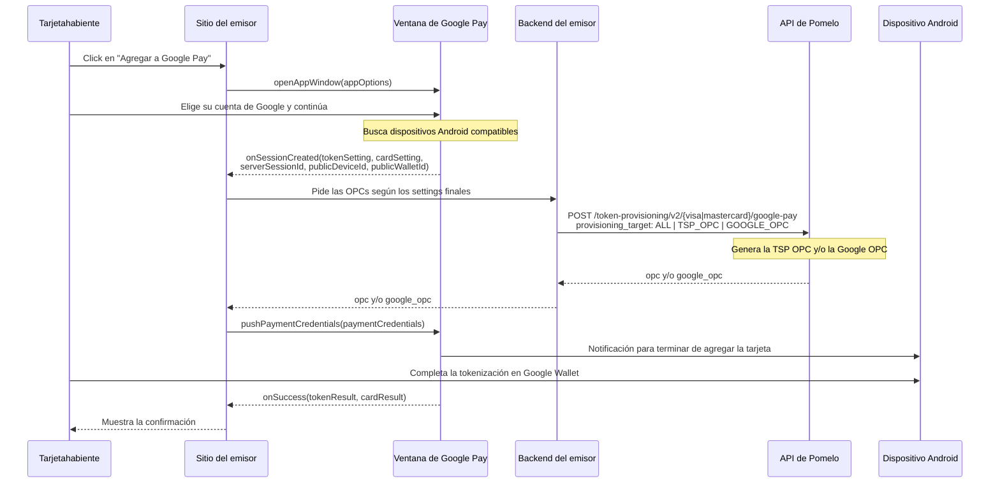

# Ejemplo de Google Pay Web Push Provisioning

> [!IMPORTANT]
> Este repositorio contiene un ejemplo básico de una integración con Google Pay Unified Web Push Provisioning.
> Usalo solo como muestra de referencia y validá siempre los detalles de implementación con la documentación oficial provista por Google.
> Bajo ninguna circunstancia debería usarse el código de este repositorio en producción.

Web Push Provisioning permite que el tarjetahabiente agregue su tarjeta a Google Pay **desde el sitio web del emisor**, sin necesidad de una app nativa. Desde el navegador, el usuario elige su cuenta de Google y Google se encarga de:

- **Tokenizar** la tarjeta en un dispositivo Android del usuario (token).
- **Guardar** la tarjeta (FPAN) en la cuenta de Google del usuario.

Este ejemplo pide ambas cosas y se adapta a lo que Google confirme en cada sesión.

| Sitio del emisor | Ventana de Google Pay | Finalización en el dispositivo |
| --- | --- | --- |
|  |  |  |

## Prerrequisitos

### Google

- Acceso a la documentación de Google: [Google Pay Unified Web Push Provisioning API](https://developers.google.com/pay/issuers/apis/push-provisioning/web/frontend-javascript-api).
- La librería JavaScript de Google descargada (ver [Integrar la librería](#integrar-la-librería)).
- El `integratorId` (Merchant ID) asignado por Google, que se encuentra en la [Issuer Console](https://pay.google.com/business/console?business_type=financial_institution). Ver [cómo obtener el Merchant ID](https://developers.google.com/pay/issuers/overview/get-started#retrieve_merchant_id).
- Los origins del sitio (por ejemplo `https://mi-banco.com`) registrados en Google para ese `integratorId`. Google valida el par `integratorId` + origin contra una allowlist.
- Para guardar la tarjeta (FPAN) en la cuenta de Google: haber completado el formulario de Google indicando que Pomelo es tu program manager. No hace falta intercambiar claves PGP con Google: Pomelo genera la Google OPC.

### Pomelo

- Credenciales OAuth de Pomelo (`client_id`, `client_secret`, `audience`). Ver [Autenticación](https://developers.pomelo.la/api-reference/home/auth).
- Una tarjeta Visa o Mastercard emitida por Pomelo.

> [!IMPORTANT]
> Pomelo no soporta un ambiente de test para Web Push Provisioning.

### Tarjetahabiente

- Un navegador soportado: últimas versiones de Chrome, Firefox, Edge o Safari, en desktop o mobile.
- Una cuenta de Google. Para tokenizar, además, un dispositivo Android compatible asociado a esa cuenta.

## Integrar la librería

### 1. Descargar y cargar la librería

Descargá la librería desde la [documentación de Google](https://developers.google.com/pay/issuers/apis/push-provisioning/web/frontend-javascript-api#quick_start) y servila desde tu sitio. En este ejemplo se espera en `public/integration-1.6.min.js` (no está versionada en el repositorio).

La librería crea el namespace `window.googlepay` y tiene que estar cargada **antes** de que el usuario haga click en el botón:

```html
<script src="/integration-1.6.min.js"></script>
```

### 2. Agregar el botón "Agregar a Google Pay"

Usá la imagen oficial servida por Google, siguiendo las [brand guidelines](https://developers.google.com/pay/issuers/apis/push-provisioning/web/frontend-javascript-api#brand_guidelines):

```html
<!-- Reservá entre 100 y 300px de ancho; el tamaño real depende del idioma. -->

```

> [!WARNING]
> El atributo `rel="opener"` es obligatorio. Sin él, el flujo falla con el error `E008`.

### 3. Abrir la ventana de Google Pay en el click

`openAppWindow` tiene que ser **lo primero** que se ejecuta en el handler del click. Cualquier request de red o trabajo pesado antes hace que el navegador trate la ventana como un popup no solicitado y la bloquee. Por eso las credenciales de pago **no** se piden en el click, sino más tarde, en `onSessionCreated`.

```ts
button.addEventListener("click", () => {
  window.googlepay.openAppWindow({
    integratorId: "<MERCHANT_ID>",
    tokenSetting: 1, // pedir tokenizar en el dispositivo
    cardSetting: 1, // pedir guardar la tarjeta en la cuenta de Google
    hl: "es-419",
    onSessionCreated: async (payload) => {
      /* pedir las OPCs al backend y llamar a pushPaymentCredentials */
    },
    onSuccess: (payload) => {},
    onFailure: (payload) => {},
    onCancel: () => {},
  });
});
```

La implementación completa está en [`lib/google/use-google-pay-provisioning.ts`](lib/google/use-google-pay-provisioning.ts).

## Flujo de Web Push Provisioning



1. **Click**: el sitio llama a `openAppWindow` y Google abre su propia ventana. Ahí el usuario elige su cuenta de Google.
2. **Sesión creada**: Google llama a `onSessionCreated` con los settings finales y los identificadores de la sesión y del dispositivo.
3. **OPCs**: el sitio le pide al backend del emisor las credenciales de pago encriptadas (OPCs), y el backend se las pide a la API de Pomelo.
4. **Credenciales**: el sitio arma el payload `PaymentCredentials` y se lo entrega a Google con `pushPaymentCredentials`.
5. **Resultado**: Google completa la tokenización en el dispositivo y/o guarda la tarjeta en la cuenta, y reporta el resultado vía `onSuccess`, `onFailure` u `onCancel`.

### Settings finales y `provisioning_target`

Aunque se pidan ambas cosas en `openAppWindow`, **Google puede degradar la sesión**. Por ejemplo, si el usuario no tiene un Android que soporte pagos tokenizados, `tokenSetting` llega en `0` y el flujo sigue como "solo guardar tarjeta". Por eso siempre hay que usar los valores que llegan en `onSessionCreated`:

| `tokenSetting` | `cardSetting` | `provisioning_target` | Se envía a Google |
| --- | --- | --- | --- |
| `1` | `1` | `ALL` | `tokenCredentials` + `cardCredentials` |
| `1` | `0` | `TSP_OPC` | `tokenCredentials` |
| `0` | `1` | `GOOGLE_OPC` | `cardCredentials` |

> [!WARNING]
> Las credenciales se **deben** enviar después de `onSessionCreated`. Si nunca se envían (por ejemplo, porque falló el pedido de OPCs), la ventana de Google queda en un loader hasta que expira con `E302`. En ese caso conviene cerrarla con `window.googlepay.closeAppWindow()`.

## Generación de OPCs con la API de Pomelo

La API de Pomelo genera la **TSP OPC** (para tokenizar) y/o la **Google OPC** (para guardar la tarjeta), según `provisioning_target`. Visa y Mastercard reciben los mismos parámetros; solo cambia el endpoint:

- Visa: `POST /token-provisioning/v2/visa/google-pay` ([documentación](https://developers.pomelo.la/api-reference/tokenization/push-provisioning/provisioning-visa-in-google-pay-upp))
- Mastercard: `POST /token-provisioning/v2/mastercard/google-pay`

| Campo | Origen | Requerido |
| --- | --- | --- |
| `card_id` | ID de la tarjeta en Pomelo | Siempre |
| `provisioning_target` | `ALL`, `TSP_OPC` o `GOOGLE_OPC` (por defecto `ALL`) | No |
| `server_session_id` | `serverSessionId` de `onSessionCreated` | Con `GOOGLE_OPC` o `ALL` |
| `device_id` | `publicDeviceId` de `onSessionCreated` | Con `TSP_OPC` o `ALL` |
| `wallet_account_id` | `publicWalletId` de `onSessionCreated` | Con `TSP_OPC` o `ALL` |
| `user_id` | ID del usuario en Pomelo | No |

Google solo envía `publicDeviceId` y `publicWalletId` cuando va a tokenizar (`tokenSetting = 1`).

```json
{
  "data": {
    "opc": "eyJmdW5kaW5nQWNjb3VudEluZm8i...",
    "google_opc": "eyJmdW5kaW5nQWNjb3VudEluZm8i..."
  }
}
```

### Formato de las OPCs para Google

Google **no** espera los bytes decodificados de la OPC. Espera un `Uint8Array` con los códigos ASCII del propio string base64 (base64 estándar, no URL-safe). Como Pomelo ya devuelve las OPCs en base64, alcanza con codificar el string como texto:

```ts
const opaquePaymentCard = new TextEncoder().encode(opcs.opc);
```

## Manejo de resultados

| Callback | Cuándo se llama | Qué hacer |
| --- | --- | --- |
| `onSuccess` | Se tokenizó, se guardó la tarjeta, o ambas. | Revisar `tokenResult` y `cardResult`: el éxito puede ser parcial. |
| `onFailure` | No se tokenizó ni se guardó nada. | Google ya mostró el error en su ventana; usarlo para logging (`errors[].errorCode`). |
| `onCancel` | El usuario cerró la ventana antes de terminar. | Lo más probable es que no se haya hecho nada, pero no es seguro. |

Además, `openAppWindow` puede lanzar una excepción sincrónica con un código `E4xx` cuando no puede abrir la ventana (por ejemplo `E411` si el navegador bloqueó el popup).

> [!NOTE]
> El éxito puede ser parcial: si se pidieron ambas cosas y la tokenización falla después de enviar las credenciales (`E303`–`E308`), Google igual guarda la tarjeta y llama a `onSuccess` con `tokenResult = 0`. El detalle llega en `debugInfo.nonFatalErrors`.

## Seguridad

- Las credenciales OAuth de Pomelo viven **solo en el backend** del emisor y nunca llegan al navegador.
- El sitio nunca maneja el PAN completo: solo viaja encriptado dentro de las OPCs.
- Las OPCs son opacas para el emisor y para el navegador. Solo Google y la red pueden leerlas.
- Los datos que se envían en claro en `PaymentCredentials` (`displayName`, `lastDigits`, `userAddress`) no son sensibles.

## Piezas clave

| Archivo | Responsabilidad |
| --- | --- |
| [`lib/google/use-google-pay-provisioning.ts`](lib/google/use-google-pay-provisioning.ts) | Flujo completo: `openAppWindow`, `onSessionCreated`, armado de `PaymentCredentials` y callbacks. |
| [`lib/pomelo/push-provisioning.ts`](lib/pomelo/push-provisioning.ts) | Backend del emisor: pide la TSP OPC y/o la Google OPC a la API de Pomelo. |
| [`lib/pomelo/auth.ts`](lib/pomelo/auth.ts) | Obtiene el access token de Pomelo (OAuth 2.0 client credentials). |
| [`lib/pomelo/user.ts`](lib/pomelo/user.ts) | Dirección del tarjetahabiente para `PaymentCredentials.userAddress` (simulada). |
| [`lib/google/config.ts`](lib/google/config.ts) | `integratorId` de Google. |
| [`lib/google/google-pay-types.ts`](lib/google/google-pay-types.ts) | Tipos de la librería de Google (`window.googlepay`). |
| [`components/add-to-google-pay-button.tsx`](components/add-to-google-pay-button.tsx) | Botón oficial y mensajes al usuario según el resultado. |

El código tiene comentarios que explican cada paso del flujo.

## Ejecutar el ejemplo

> [!IMPORTANT]
> No es posible probar el flujo con Google desde `localhost`. Google valida el origin del sitio contra la allowlist del `integratorId`, así que el ejemplo tiene que estar desplegado en la URL declarada en Google (si no, la ventana de Google falla con `E102`).

1. Descargá la librería de Google y guardala en `public/integration-1.6.min.js`.
2. Copiá `.env.example` a `.env` y completá las variables:

   | Variable | Descripción |
   | --- | --- |
   | `POMELO_BASE_URL` | URL base de la API de Pomelo. |
   | `POMELO_AUDIENCE` | Audience de OAuth de Pomelo. |
   | `POMELO_CLIENT_ID` | Client ID de OAuth de Pomelo. |
   | `POMELO_CLIENT_SECRET` | Client secret de OAuth de Pomelo. |
   | `POMELO_CARD_ID` | ID de la tarjeta a provisionar (por ejemplo `crd-...`). |
   | `NEXT_PUBLIC_GOOGLE_PAY_INTEGRATOR_ID` | Merchant ID de la Issuer Console de Google. |

3. Instalá las dependencias y generá el build:

   ```bash
   npm install
   npm run build
   ```

4. Desplegá el sitio en la URL declarada en Google para tu `integratorId` y probá el flujo desde ahí.

## Troubleshooting

| Código | Causa probable | Solución |
| --- | --- | --- |
| `E101` | El `integratorId` no está autorizado. | Verificá el Merchant ID en la Issuer Console. |
| `E102` | El origin del sitio no está autorizado para el `integratorId`. | Registrá el origin con Google. |
| `E114` | Google no tiene configurado el guardado de la tarjeta (FPAN) para el `integratorId`. | Completá el formulario de Google indicando que Pomelo es tu program manager. |
| `E302` | Las credenciales de pago no llegaron a tiempo. | Revisá que se llame a `pushPaymentCredentials` y que no falle el pedido de OPCs. |
| `E008` | Falta `rel="opener"` en la imagen del botón. | Agregá `rel="opener"` al ``. |
| `E410` | La ventana de Google ya estaba abierta. | Evitá llamar a `openAppWindow` dos veces. |
| `E411` | El navegador bloqueó la ventana. | Llamá a `openAppWindow` directo en el click, sin trabajo previo. |

La lista completa está en [Error codes](https://developers.google.com/pay/issuers/apis/push-provisioning/web/frontend-javascript-api#errorCodes).

## Referencias

- [Google Pay Unified Web Push Provisioning API](https://developers.google.com/pay/issuers/apis/push-provisioning/web/frontend-javascript-api)
- [Provisioning Visa en Google Pay (Pomelo)](https://developers.pomelo.la/api-reference/tokenization/push-provisioning/provisioning-visa-in-google-pay-upp)
- [Autenticación (Pomelo)](https://developers.pomelo.la/api-reference/home/auth)
