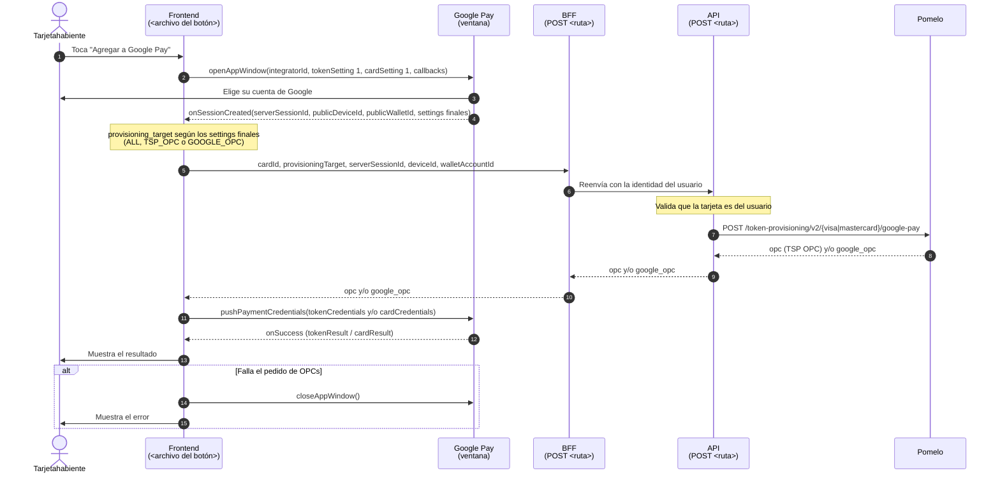

# Diagrama de secuencia de la integración

Al terminar, el resumen final incluye un diagrama de secuencia en Mermaid con **cómo quedó la integración en este proyecto**. Adaptá la plantilla: usá los nombres reales (rutas, archivos, funciones) y quitá o agregá participantes según las capas que existan.

## Cómo mostrarlo

Que se vea **dibujado**, no como código Mermaid en la terminal:

1. **Si tenés la herramienta `Artifact`** (o una de vista previa de HTML), generá una página HTML autocontenida con el diagrama y publicala como artifact privado. Usá la plantilla de abajo, con tu diagrama adaptado en el `<pre class="mermaid">`. Decile al usuario el link y que el diagrama sale de la integración recién hecha.
2. **Si no tenés ninguna**, mostrá el bloque ` ```mermaid ` en el resumen, que muchos clientes renderizan, y no escribas archivos nuevos en el proyecto del usuario.

Plantilla HTML (modo claro y oscuro, sin dependencias salvo Mermaid desde cdnjs con versión fija):

```html
<!doctype html>
<html lang="es">
<head>
  <meta charset="utf-8" />
  <meta name="viewport" content="width=device-width, initial-scale=1" />
  <title>Flujo Google Pay web</title>
  <style>
    :root { --bg: #ffffff; --fg: #1a1a1a; }
    @media (prefers-color-scheme: dark) { :root:not([data-theme="light"]) { --bg: #14161a; --fg: #e8e8e8; } }
    :root[data-theme="dark"] { --bg: #14161a; --fg: #e8e8e8; }
    body { background: var(--bg); color: var(--fg); font-family: system-ui, sans-serif; margin: 0; padding: 16px; }
    .mermaid { overflow-x: auto; }
  </style>
</head>
<body>
  <h1>Flujo Google Pay web push</h1>
  <pre class="mermaid">
<!-- acá va el sequenceDiagram adaptado al proyecto -->
  </pre>
  <script src="https://cdnjs.cloudflare.com/ajax/libs/mermaid/10.9.1/mermaid.min.js"></script>
  <script>
    const dark = window.matchMedia("(prefers-color-scheme: dark)").matches;
    mermaid.initialize({ startOnLoad: true, theme: dark ? "dark" : "default" });
  </script>
</body>
</html>
```

## Reglas

- **Participantes:** incluí solo las capas reales. Una sola capa: `Backend`. BFF y API separadas: `BFF` y `API`.
- **Etiquetas con nombres reales:** la ruta del endpoint (`POST /api/google-pay/opcs`), el archivo o la función donde está cada paso.
- **Lo pendiente se marca:** si una capa no se implementó en este repo, dibujala igual con una nota `Pendiente: la implementa el equipo de <capa>`.
- **El orden importa:** `openAppWindow` va primero y sin pasos previos; las OPCs se piden recién en `onSessionCreated`.

## Plantilla (BFF y API separadas)



## Variante con un solo backend

Quitá el participante `B` y las dos flechas del BFF; `F` llama directo a `Backend`, que valida la tarjeta y llama a Pomelo.
