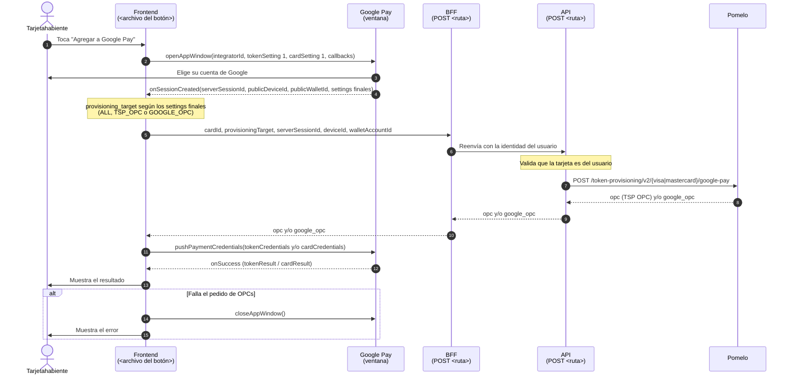

# Diagrama de secuencia de la integración

Al terminar, el resumen final incluye un diagrama de secuencia en Mermaid con **cómo quedó la integración en este proyecto**. Adaptá la plantilla: usá los nombres reales (rutas, archivos, funciones) y quitá o agregá participantes según las capas que existan.

## Reglas

- **Participantes:** incluí solo las capas reales. Una sola capa: `Backend`. BFF y API separadas: `BFF` y `API`.
- **Etiquetas con nombres reales:** la ruta del endpoint (`POST /api/google-pay/opcs`), el archivo o la función donde está cada paso.
- **Lo pendiente se marca:** si una capa no se implementó en este repo, dibujala igual con una nota `Pendiente: la implementa el equipo de <capa>`.
- **El orden importa:** `openAppWindow` va primero y sin pasos previos; las OPCs se piden recién en `onSessionCreated`.

## Plantilla (BFF y API separadas)

## Variante con un solo backend

Quitá el participante `B` y las dos flechas del BFF; `F` llama directo a `Backend`, que valida la tarjeta y llama a Pomelo.
